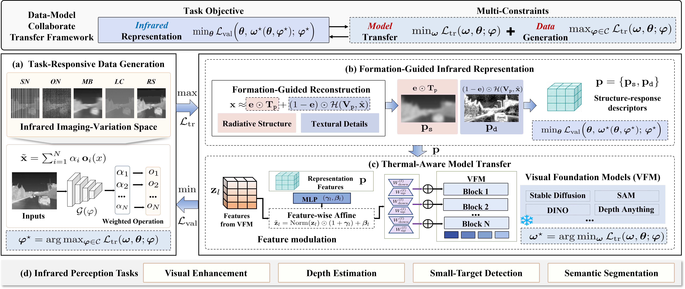

<div align="center">

# Bridging the Thermal Gap: Data-Model Collaborative Transfer for Infrared Perception

**Zhu Liu · Qilong Zhao · Zhirui Fang · Benzhuang Zhang · Jinyuan Liu · Risheng Liu**

[](#citation)
[](#method-overview)
[](#training)
[](#checkpoints)

**A data-model collaborative framework for robust infrared visual perception.**

[Method](#method-overview) · [Results](#final-results) · [Installation](#setup) · [Training](#training) · [Citation](#citation)



*Overview of the framework: task-responsive data generation, formation-guided infrared representation, and thermal-aware model transfer, evaluated across four infrared perception tasks.*

</div>

## ✨ Method overview

Infrared perception must handle imaging variations such as low contrast, blur, sensor and optical noise, and changes in resolution. The paper couples training-data construction with model transfer through four components:

- **Task-responsive data generation** learns weights over plausible infrared imaging variations to construct informative observations.
- **Formation-guided representation** derives complementary structure-dominant and response-detail cues from thermal images.
- **Thermal-aware model transfer** uses those cues to condition lightweight adapters while keeping the foundation-model backbone frozen.
- **Single-loop collaborative optimization** updates data generation and model transfer together without repeated inner-loop convergence.

The paper evaluates the framework on **infrared image enhancement, depth estimation, small-target detection, and semantic segmentation**.

## 📊 Final results

Table IV reports the final Ours results for infrared small-target detection. Run-level checkpoint evaluations and file hashes are catalogued separately in [`MODEL_CHECKPOINTS.md`](MODEL_CHECKPOINTS.md) and the linked weights Release.

| Dataset | Method | mIoU ↑ | F1 ↑ | Pd ↑ | Fa ↓ |
|:--|:--:|--:|--:|--:|--:|
| NUDT-SIRST | **Ours** | **95.26** | **97.57** | **99.26** | **0.00000064** |
| IRSTD-1K | **Ours** | **66.40** | **79.81** | **92.26** | **0.00002019** |
| IRSTDID-SKY | **Ours** | **72.65** | **84.16** | **98.72** | **0.00000079** |
| Overall | **Ours** | **78.10** | **87.18** | **96.75** | **0.00000743** |

> The linked weights Release contains the archived Ours checkpoints, per-file SHA-256 values, and available run metadata. [`MODEL_CHECKPOINTS.md`](MODEL_CHECKPOINTS.md) summarizes the recorded checkpoint evaluations.

See [`CHECKPOINT_RELEASE_NOTES.md`](CHECKPOINT_RELEASE_NOTES.md) for the archive contents and per-dataset summary.

### Infrared semantic segmentation on FMB

The final FMB segmentation method uses DINOv2 with AdamW at an initial learning rate of `1e-4`. The adapter follows transformer blocks, and frequency decomposition is applied in feature space. Table V evaluates ×2 and ×4 resolution degradation; Table VI evaluates moderate and severe stripe noise. The paper reports the mIoU values below.

| FMB evaluation setting | Method | mIoU (%) |
|:--|:--:|--:|
| ×2 scaling factor | **Ours** | **52.03** |
| ×4 scaling factor | **Ours** | **51.13** |
| Moderate stripe noise | **Ours** | **50.93** |
| Severe stripe noise | **Ours** | **50.56** |

The linked weights Release includes FMB segmentation checkpoints and their available run records. The table below lists the final paper results; recorded checkpoint evaluations are summarized in [`MODEL_CHECKPOINTS.md`](MODEL_CHECKPOINTS.md).

## 🧪 Small-target detection configuration

The final small-target detection configuration uses the following shared settings.

| Dataset | Input resolution | Training | Optimizer | Initial learning rate |
|:--|:--:|:--:|:--:|--:|
| NUDT-SIRST | 256 × 256 | 300 epochs | Adam | 0.01 |
| IRSTD-1K | 512 × 512 | 300 epochs | Adam | 0.01 |
| IRSTDID-SKY | 512 × 512 | 300 epochs | Adam | 0.01 |

The paper specifies resolution, epochs, optimizer, and initial learning rate. The launch scripts use batch sizes of 12 for NUDT-SIRST and 8 for IRSTD-1K and IRSTDID-SKY, with seed 2727 and the included fixed split manifests.

The detector's lower and upper bilevel parameter groups use Adam; the upper group retains the trainer's half-rate setting. The noise generator uses SGD. NG and bilevel optimization begin at epoch 25, with the original losses, alpha schedule, and update equations. The Release manifest lists each archived run and its recorded configuration.

The launch scripts expose implementation-specific options such as noise-generator scaling and checkpoint save cadence as explicit overrides.

This repository provides the small-target detection implementation. The linked [weights Release](https://github.com/QilongZhao-86/DMCT_InfraredVision/releases/tag/ours-checkpoints-2026-11-12) contains 39 Ours checkpoint files across detector and FMB segmentation experiments, with SHA-256 manifests and run records. Dataset images and masks are obtained separately from their providers.

## 🧰 Contents

- Model and training code: `infrared_model/`, `training/`, `dataset/`, `train_final.py`, and `training.py`.
- Paper-aligned dataset defaults: `dataset/experiment_defaults.py`.
- Per-run config, split, and source-hash capture: `training/run_metadata.py`.
- Portable Linux launch examples: `scripts/`.
- Fixed train/validation IDs and official IRSTDID-SKY test IDs: `reproducibility/`.
- Checkpoint inventory and hashes: `MODEL_CHECKPOINTS.md`, `CHECKPOINT_SHA256SUMS.txt`.
- Dataset and environment guidance: [`DATASETS.md`](DATASETS.md), [`ENVIRONMENT.md`](ENVIRONMENT.md).
- Citation metadata: `CITATION.cff`.
- Third-party notices: [`THIRD_PARTY_NOTICES.md`](THIRD_PARTY_NOTICES.md).

## ⚙️ Setup

Use Linux with a CUDA-capable PyTorch installation. `environment.yml` records the environment used for archived runs; it is not a cross-platform lockfile. See [`ENVIRONMENT.md`](ENVIRONMENT.md) for setup details.

Download the SAM 2.0 Hiera Tiny pretrained checkpoint from the official SAM 2 release and place it at:

```text
infrared_model/sam2_ckpt/sam2_hiera_tiny.pt
```

## 🗂️ Dataset layout

Set `DATA_ROOT` to the dataset package root. It must contain each canonical dataset directory with `images/` and `masks/`, plus the provider's `set_configs/<dataset>/train.txt` and `test.txt` lists for NUDT-SIRST and IRSTD-1K. SKY's canonical lists are supplied in `reproducibility/IRSTDID-SKY/`. Fixed train/validation ID files are supplied in `reproducibility/<dataset>/`. Obtain image and mask data from official providers and follow their terms. See [`DATASETS.md`](DATASETS.md).

## 🚀 Training

The launch scripts take paths from environment variables and contain no machine-specific server paths. They choose resolution and batch defaults from the dataset name, and accept explicit overrides. The examples use the paper-reported resolution, epoch count, detector optimizer, and initial learning rate.

**NUDT-SIRST**

```bash
DATA_ROOT=/datasets/IRSTD \
SPLIT_DIR=reproducibility/NUDT-SIRST \
DATASET=NUDT-SIRST \
BATCH_SIZE=12 IMAGE_SIZE=256 EPOCHS=300 LR=0.01 SEED=2727 \
SAVE_DIR=outputs/nudt-ours \
bash scripts/train_ours.sh
```

**IRSTD-1K**

```bash
DATA_ROOT=/datasets/IRSTD \
SPLIT_DIR=reproducibility/IRSTD-1K \
DATASET=IRSTD-1K \
BATCH_SIZE=8 IMAGE_SIZE=512 EPOCHS=300 LR=0.01 SEED=2727 \
SAVE_DIR=outputs/irstd1k-ours \
bash scripts/train_ours.sh
```

**IRSTDID-SKY**

```bash
DATA_ROOT=/datasets/IRSTD \
SPLIT_DIR=reproducibility/IRSTDID-SKY \
DATASET=IRSTDID-SKY \
BATCH_SIZE=8 IMAGE_SIZE=512 EPOCHS=300 LR=0.01 SEED=2727 \
SAVE_DIR=outputs/sky-ours \
bash scripts/train_ours.sh
```

The learned-NG training script starts NG and bilevel optimization at epoch 25 and retains the original loss, alpha schedule, and update equations. The documented Ours entrypoint is `train_final.py` with `scripts/train_ours.sh`; the plain-detector comparison uses `training.py` with `scripts/train_baseline.sh`. Launch scripts provide portable examples for adapting these runs to a scheduler.

Each training run writes `run_config.json`, `source_sha256.txt`, and exact copies of its train/validation ID lists under `SAVE_DIR`. Reusing a populated run directory for a new run is rejected; use a new `SAVE_DIR` (or `--resume` for a recorded Ours run). The official test list is read only to check split disjointness; its images and masks are not loaded during training or checkpoint selection.

## 🔬 Evaluation

Select a checkpoint using the fixed internal-validation split, then lock it before evaluating on its matching official test list. Do not use official-test results for checkpoint or hyperparameter selection.

```bash
DATA_ROOT=/datasets/IRSTD \
DATASET=IRSTDID-SKY IMAGE_SIZE=512 BATCH_SIZE=8 SEED=2727 \
WEIGHTS=/path/to/sky_ours_checkpoint.pth \
TEST_LIST=reproducibility/IRSTDID-SKY/official_test_ids.txt \
RESULTS_DIR=outputs/sky-ours-test \
bash scripts/evaluate_checkpoint.sh
```

The evaluator writes a timestamped `evaluation_config_*.json`, a source-hash manifest, and a copy of the exact test ID list under `RESULTS_DIR`. It also records the evaluated checkpoint's SHA-256.

## 📚 Citation

Zhu Liu, Qilong Zhao, Zhirui Fang, Benzhuang Zhang, Jinyuan Liu, and Risheng Liu, “Bridging the Thermal Gap: Data-Model Collaborative Transfer for Infrared Perception,” *IEEE Transactions on Pattern Analysis and Machine Intelligence*.

## 📄 License and third-party code

Third-party notices are listed in [`THIRD_PARTY_NOTICES.md`](THIRD_PARTY_NOTICES.md).
